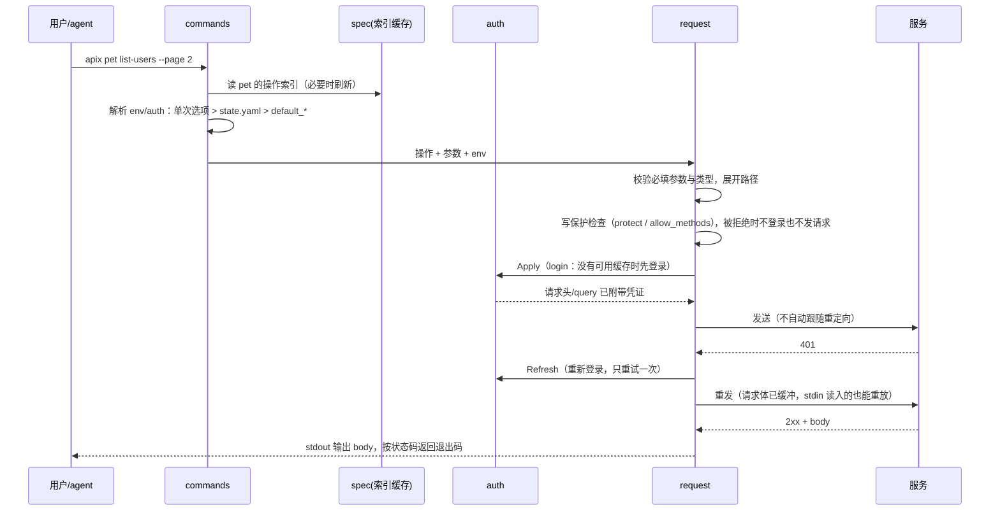

<!-- template_id: design; template_version: 1.2.0 -->
# apix：按 API 定义动态生成命令的通用 API CLI 设计

> 状态：Draft 0.2 / 已批准（用户 2026-11-10：“批准 apix 设计 0.2（接受未复核修订），Q1/Q2 按推荐，开始写一期计划”；Q1 不读当前目录 `.env`，Q2 位置参数与 `--api` 并存；设计批准只授权进入规划，不授权实施）

## 修订记录

| 版本 | 日期 | 作者 | 摘要 |
|---|---|---|---|
| 0.1 | 2026-11-10 | Claude（inhere 确定方向：自研、名为 apix、配置目录 `~/.config/apix` + 同目录 `.env`、支持自定义简单站点定义、写完整设想、实施先做一期） | 初稿：统一操作模型、OpenAPI 与简单定义两种来源、环境与认证分离、操作与原始路径两种调用、面向 agent 的约束、快捷命令、三期路线 |
| 0.2 | 2026-11-10 | Claude | 处理第 1 轮合并轴评审（A1–A2 阻塞，B1–B9 纠正，S1–S5 建议）：token 缓存按 env 隔离并带指纹；站点写入改为只写 `sites/*.yaml`，简单定义移到 `defs/`；补 gcli 实测约束（原始路径参数、`--api` 改写、全局选项双注册、退出码统一）；补 URL 组成与 basePath；凭证不出主机（路径、重定向）；按来源打码；快捷命令的命名、哈希与 cmd 限制；写保护提到认证之前；登记 SR2003 偏离；`.env` 只解析不写进程环境 |

> 仅语义变化递增版本；纯 identity/provenance/元数据纠正沿用原版本，并在 Git/进度记录中留痕。

## 设计工作声明

- 思考模式：`RIGOROUS`（SR1408）。
- 核心目标：用一个通用 CLI 调用任意内部 HTTP 服务。服务由 OpenAPI 文档或简单 YAML 定义描述，自动生成命令，自带环境与认证；人和 agent 都能直接用，不必再给每个服务写 CLI。
- Scope freeze：写完整设想（三期），但只把一期定到可写计划的程度；二、三期只列方向，不展开细节。
- 暴露度：新项目，未发布、无用户与生产数据，可廉价重建（SR1409 低暴露）。评审封顶一轮合并轴评审。
- 停止条件：一轮评审无开放 `CORE_BLOCKING`，或由用户裁决；之后进入人工计划 Gate。

## 背景与目标

现在内部有好几个工具服务，只有 Web 页面或 HTTP 接口，没有 CLI，带来三个问题：

1. agent 无法操作这些服务，只能由人去页面上点。
2. curl 能用，但每次都要手动拼 base URL、认证头和 JSON 请求体；token 过期后还要自己重新登录。
3. 给每个服务单独写 CLI，成本太高。

期望的最终效果：

```bash
apix site add pet --spec https://pet.internal/swagger.json    # 注册一次
apix pet list-users --page 2                                  # 按操作调用：参数来自定义，可补全
apix pet -X POST /api/users -f name=tom                       # 按路径调用：自动带 base URL 与认证
apix use pet --env test --auth admin                          # 切换环境与身份
apix link pet --name petctl                                   # 生成快捷命令，之后用 petctl list-users
```

接口少的服务（例如 Jenkins，或只有几个接口的小工具服务）写一份 swagger 太麻烦。这类服务改用十几行 YAML 定义，用法和 swagger 站点完全一样。

调研结论：已有工具里 [Restish](https://github.com/rest-sh/restish) 最接近这个需求，它是 Go 写的，运行时加载 OpenAPI，支持多 profile 认证。自研的理由是 Restish 缺下面几项，而这几项正是内部服务的常态：

- 公开资料只写了支持 OAS 3.x，内部 Go 服务用 swaggo 生成的多为 Swagger 2.0。
- 不支持“先登录拿 token、过期后自动重登”的认证方式。
- 不支持无 spec 的简单站点定义。
- 不针对 agent 做约束（稳定输出、退出码、写操作保护）。
- 不支持在 Windows 上生成快捷命令。

## 名词

| 名词 | 含义 |
|---|---|
| 站点（site） | 一个被调用的 API 服务，有唯一名字（如 `pet`、`jenkins`），对应一份定义来源和若干环境、认证 |
| 定义来源（source） | 站点的接口描述：`openapi`（OpenAPI 3.x / Swagger 2.0，URL 或文件）或 `simple`（apix 自有的简单 YAML） |
| 操作（operation） | 一个可调用接口：方法、路径模板、参数、请求体类型。两种来源都转换成同一个操作模型 |
| 操作索引（op index） | 从定义来源转换出的操作列表，缓存在本地，命令构建只读它 |
| 环境（env） | 站点的一个部署实例：base URL、TLS 选项、是否受保护（如 dev/test/prod） |
| 认证（auth） | 站点的一个身份：认证类型及其参数（如 admin/readonly/me） |
| 当前选择（selection） | 每个站点当前用哪个 env 和 auth，由 `apix use` 写入 state 文件 |
| 密钥引用 | 配置里用 `${env:NAME}` 引用密钥，值来自 OS 环境变量或配置目录的 `.env` |
| 快捷命令（link） | 为站点生成的小脚本（如 `petctl`），内部调用 `apix <site>` 并预带选项 |

## 范围与非目标

**范围（全部设想，按期交付，分期见“分期路线”）**：

- 站点管理：添加、列出、查看、删除，刷新定义。
- 两种定义来源：OpenAPI 3.x / Swagger 2.0，以及简单定义。
- 两种调用：按操作调用，按原始路径调用。
- 环境与认证分开配置，可以切换，也可以只对单次请求覆盖。
- 认证类型：none、bearer、basic、apikey、login（登录换 token、自动重登）。二期加 oauth2、exec。
- 输出与退出码稳定，可 dry-run 打印等价 curl，对写操作有保护。
- 快捷命令。
- 二期起：补全、定义覆盖（overlay）、输出过滤、生成 agent skill。三期起：MCP 模式。

**非目标**：

- 不做 GraphQL、gRPC、WebSocket。
- 不做 mock 服务（已有 `fakeserver`）。
- 不做 SDK 或代码生成。
- 不做多人共享的配置中心。
- 不负责 spec 的自动发现：一期由用户给出 spec 地址。

**受影响项目**：只有新仓库 `inhere-tools/apix`。依赖 gookit 的 `gcli`、`goutil`、`greq`，只做使用、不改动；需要改动时另立 issue。

## 已确认事实与规范

- 规范：入口薄、命令放 `internal/commands`（GR107）；装配只装配（GR108）；不吞写入错误（GR109）；CLI 经真实分发测试（GR110）；gcli 位置参数先声明再取值，选项绑定命令结构体，入口 `os.Exit(app.Run(nil))`（SR2003）；目录结构参照 gofer 与 suga（SR2004）；测试断言用 `goutil/x/assert`（SR2002）。
- gcli 的 `App.Add`/`AddCommand` 可以在 `Run` 前注册命令，`Command.Subs` 支持子命令（`gookit2/gcli/app.go:221`、`cmd.go:98`）。动态命令的做法：先预扫描 argv 定位站点名，只为该站点注册命令，再调用 `app.Run`。
- gcli 行为（评审在最小程序上实测）：
  - 命令没有声明位置参数时，多出来的位置参数会被当作子命令名，报 not found 并退出 2（`gcli/cmd.go:484-500`）。
  - app 级 flagset 不重排参数，解析遇到第一个非选项就停（`app.go:106-113`）。
  - 选项同时注册在 `app.Flags()` 和 `<site>` 的 SharedOpts 上并绑定同一变量时，写在站点名前、站点名后、操作名后都能解析。
  - 全局层出现未知选项时退出 0（`app.go:555-556`）。
  - 命令返回的普通 error 映射为 2（`app.go:571-575`）。
- 配置目录与 `.env` 的先例在 gofer：配置目录为 `$GOFER_CONFIG_DIR` 或 `~/.config/gofer`，依次加载配置目录和当前目录的 `.env`，已导出的 OS 环境变量优先（`inhere-tools/gofer/internal/config/dotenv.go:40-72`）。
- `goutil/envutil` 加载 `.env` 时会调用 `os.Setenv`，并把键名转成大写（`dotenv.go:137-143`）。所以 apix 只解析 `.env` 文件格式，得到的值存进自己的 map，不写进程环境，键名区分大小写（D14）。
- HTTP 客户端用 `gookit/greq`。
- OpenAPI 解析候选是 kin-openapi：支持 3.x，`openapi2conv` 负责 2.0→3.0 转换。最终选型在计划阶段用两份真实内部 spec 核实（见 Q4）。
- Restish 的能力与边界来自公开资料（pkg.go.dev、项目文档），只作参考。

## 总体方案

核心是**统一操作模型**：不论来源是 OpenAPI 还是简单定义，加载时都转换成同一份操作索引。命令构建、参数解析、请求发送和补全都只面向这份模型，以后增加新的来源不影响下游。

```
定义来源（openapi / simple）──加载+转换──▶ 操作索引（缓存）
                                              │
argv ─▶ 预扫描站点名 ─▶ 读索引并注册动态命令 ─▶ gcli 分发
                                              │
          env（base URL）＋ auth（凭证）＋ 参数 ─▶ 构造请求 ─▶ 发送 ─▶ 输出 / 退出码
```

### 配置目录

默认为 `~/.config/apix`，可用 `$APIX_CONFIG_DIR` 覆盖：

```
~/.config/apix/
  config.yaml          # 用户编辑：全局默认、站点、环境、认证（不写明文密钥）
  .env                 # 密钥：KEY=VALUE；已导出的 OS 环境变量优先
  sites/<name>.yaml    # 一个文件一个站点（结构同 config.yaml 的 sites.<name>）；自动加载；site add 写在这里
  defs/<name>.yaml     # 简单定义文件
  state.yaml           # apix 写入：各站点当前的 env/auth、已生成的快捷命令
  cache/specs/<site>.* # 原始 spec、操作索引、ETag 与获取时间
  cache/tokens/<site>.<env>.<auth>.json   # login 缓存的 token，权限 0600；带指纹
```

文件写入规则（D5）：

- apix 永远不改写 `config.yaml`。
- `site add` 只新建 `sites/<name>.yaml`。站点名已在 config.yaml 或 sites/ 中存在时报错。
- `site rm` 只删 apix 自己建的 `sites/<name>.yaml`（由 state.yaml 记录），并清理对应缓存。写在 config.yaml 里的站点拒绝删除，提示用户手动编辑。
- `apix use` 只写 state.yaml。
- state.yaml 和 token 缓存都先写临时文件再 rename，避免并发调用时写出半个文件。

**token 缓存隔离**：

- 缓存键是 `<site>.<env>.<auth>`。
- 缓存文件里记一个指纹：base_url 加上 login 配置（展开密钥前的原文）的哈希。指纹不一致时作废缓存，重新登录。
- 这样切换 env 时，不会把一个环境的 token 发到另一个环境。

### config.yaml 示例

```yaml
defaults:
  output: auto        # auto：终端下美化 JSON，管道下原样输出
  timeout: 30s
  link_dir: ~/.local/bin

sites:
  pet:
    source: {type: openapi, url: https://pet.internal/swagger/doc.json, ttl: 24h}
    envs:
      dev:  {base_url: http://127.0.0.1:8080}
      prod: {base_url: https://pet.internal, protect: true}
    default_env: dev
    auths:
      admin: {type: bearer, token: "${env:PET_ADMIN_TOKEN}"}
      ro:    {type: bearer, token: "${env:PET_RO_TOKEN}", allow_methods: [GET, HEAD]}
      me:
        type: login
        login:
          method: POST
          path: /api/login
          body: {username: "${env:PET_USER}", password: "${env:PET_PASS}"}
        token: {from: body, path: data.token}          # 取 token 的位置：body 或 header
        expires: {from: body, path: data.expires_in}   # 可选，单位秒；没有就等到 401 再重登
        apply: {header: Authorization, value: "Bearer {token}"}
    default_auth: me

  jenkins:
    source: {type: simple, file: defs/jenkins.yaml}
    envs:
      main: {base_url: https://ci.internal}
    auths:
      me: {type: basic, username: "${env:JENKINS_USER}", password: "${env:JENKINS_TOKEN}"}
```

### 简单定义（simple）

给接口少的服务用。字段尽量少，能从路径推出来的就不必写：

```yaml
# defs/jenkins.yaml
operations:
  job-info:
    get: /job/{name}/api/json          # 方法: 路径 的简写；路径里的 {name} 自动成为必填参数
    summary: 查看 job 信息
  job-build:
    post: /job/{name}/buildWithParameters
    summary: 触发参数化构建
    query: [BRANCH, ENV]               # 只写名字的 query 参数，可选、字符串类型
  job-log:
    get: /job/{name}/{build}/consoleText
    output: raw                        # 这个操作默认按纯文本输出
  create-item:
    post: /createItem
    params:                            # 完整写法：需要类型、必填、说明时用
      - {name: name, in: query, required: true, desc: 新 job 名}
    body: {type: xml}                  # 请求体类型：json（默认）/ form / xml / raw
```

简单定义只描述“怎么调用”，不描述响应结构，所以 `apix desc` 对这类站点只显示参数。

### 命令形态

```text
apix [全局选项] <site> <operation> [参数选项]            # 按操作调用
apix [全局选项] <site> -X <METHOD> <path> [请求选项]     # 按原始路径调用（-X 缺省为 GET）
apix --api <site> ...                                    # 与上面等价的写法，供脚本和快捷命令用
```

**gcli 上的落地约定**（依据见“已确认事实”中的 gcli 实测）：

- **原始路径**：`<site>` 命令声明一个可选位置参数 `path`，各操作子命令不声明位置参数。
  - `-X/-d/-f/-H` 定义在 `<site>` 命令上。
  - 作为 path 的值必须以单个 `/` 开头。否则说明用户输错了操作名，报“未知操作”并退出 2，不发请求，避免 `pet list-userz` 被当成 GET 请求发出去。
- **`--api`**：预扫描时把 `--api X` 或 `--api=X` 从 argv 中摘掉，改写成位置参数 X，再交给 `app.Run`。
  - 预扫描要知道哪些全局选项带值，才能正确跳过选项的值。
  - 预扫描还要校验全局选项；遇到未知选项时自己报错并返回 2，弥补 gcli 返回 0 的问题（另给 gcli 立 issue 修复）。
- **全局选项**：同时注册在 `app.Flags()` 和 `<site>` 的 SharedOpts 上，绑定同一变量。写在站点名前、站点名后、操作名后都能生效。

**站点名与 URL**：

- **站点名**：限定为 `^[a-z][a-z0-9-]*$`，不能含 `:`（gcli 会把它当成命令路径拆开）。
- **保留名**：站点名不能使用下表的管理命令名，也不能使用 `help`。
- **URL 组成**：
  - 按操作调用时，URL = `env.base_url` + `base_path` + 操作路径。`base_path` 默认取 Swagger 2.0 的 `basePath` 或 OAS `servers[0]` 的路径部分，env 里可以覆盖；简单定义默认为空。
  - 按原始路径调用时，URL 只是 `base_url` + path。
  - path 参数的值用 `url.PathEscape` 转义。
- **`site add` 的默认环境**：`site add` 接受 `--base-url`。没有给出时，从 spec 的 host/schemes 或 servers 生成一个名为 `default` 的 env。两者都没有时报错，所以注册完就能直接调用。
- **拉取 spec 时的认证**：`source` 可以写 `auth: <名>`。需要认证的 spec 地址用该认证去拉取，这时只允许 bearer、basic、apikey 三种认证。

管理命令都是顶层保留字，站点名不能和它们重名（`site add` 时校验）：

| 命令 | 作用 |
|---|---|
| `site add/ls/show/rm/refresh` | 管理站点。`refresh` 重新拉取定义并重建操作索引 |
| `ops <site> [--tag] [--match]` | 列出操作：名字、方法、路径、摘要 |
| `desc <site> <op>` | 查看一个操作：参数、请求体、响应结构（OpenAPI 站点才有） |
| `use <site> [--env] [--auth]` | 设置当前选择，写入 state.yaml |
| `auth ls/login/logout/status <site>` | 查看认证；手动登录或清除 token 缓存 |
| `link <site> / link ls / link rm` | 管理快捷命令 |
| `config path/show/check` | 查看配置目录；显示合并后的配置（密钥打码）；检查配置 |

**操作命令名**：取 operationId 转成 kebab-case（`listUsers` → `list-users`）。没有 operationId 时用方法加路径生成，如 `get-users-id`。重名时追加序号，并在 `site refresh` 时提示。

**参数映射**：

- path、query、header 参数都映射为同名长选项 `--<name>`。
  - 这些选项在运行时注册（如 `StrOpt`），不绑定命令结构体。这是对 SR2003 的偏离，理由见 D15。静态的管理命令仍按 SR2003 写。
  - 必填与类型由 apix 在发请求前自己校验，失败退出 1。gcli 的 Required 不用于这些选项。
- 以下情况不生成 `--<name>`，只能用 `-p name=value`（`-p` 对任何参数都可用）：
  - 参数名与全局选项冲突；
  - 参数名与 gcli 内置的 `-h/--help`、`-V/--version`、`--gen-completion` 冲突；
  - 同名参数出现在不同位置（如 path 的 `id` 和 query 的 `id`），这时写 `-p query.id=1`；
  - 参数名不是合法的选项名。
- 请求体有三种传法：
  - `-d @file.json`，`-d -` 表示从 stdin 读。
  - `-d '<json>'` 直接给内容。
  - `-f key=value` 传字符串字段；`-f key:=<json>` 按 JSON 类型传值，例如 `age:=3`、`tags:=["a"]`。
- `-f` 按点号路径合并成 JSON 对象，例如 `-f user.name=tom`。请求体是 form 类型时，`-f` 改为编码成表单。

**全局选项**（固定一组，后续只能增加不能改名）：

| 选项 | 作用 |
|---|---|
| `--env` / `--auth` | 只对本次请求覆盖当前选择 |
| `-o auto\|json\|raw` | 输出格式；二期增加 `yaml\|table` |
| `-i` | 把状态行和响应头输出到 stderr |
| `-v` | 把请求行和请求头输出到 stderr（密钥打码） |
| `--dry-run` | 不发送请求，只打印等价 curl，密钥打码 |
| `--yes` | 确认受保护环境上的写操作 |
| `--timeout` | 本次请求的超时 |
| `-H` | 追加请求头 |

## 架构

### 代码组织

参照 gofer（`inhere-tools/gofer/cmd/gofer/main.go` + `internal/commands/`）与 suga（`internal/wiring` + 分层守卫测试），目录结构无偏离（SR2004）。唯一的偏离是动态操作的选项不绑定命令结构体（SR2003，见 D15）。

```
cmd/apix/main.go           # 只注入构建信息、创建 app、os.Exit(app.Run(nil))（GR107）
internal/commands/         # gcli 命令：site.go、ops.go、use.go、auth.go、link.go、config.go、dynamic.go
                           #   dynamic.go：把操作索引翻译成 gcli 命令与选项；只做翻译，不含请求逻辑
internal/wiring/           # 构造 config、spec、auth、request 的依赖并连线（GR108）
internal/config/           # 配置目录、config.yaml/state.yaml 读写、.env、${env:} 展开、校验
internal/model/            # Site、Env、AuthSpec、Operation、Param：纯数据，不依赖其他内部包
internal/spec/             # 来源加载器：openapi（含 2.0→3.0 转换）、simple → []model.Operation；操作索引缓存
internal/auth/             # 认证提供者接口与实现：none/bearer/basic/apikey/login；token 缓存
internal/request/          # 由操作与参数构造请求、发送（greq）、401 重试、curl 渲染、打码
internal/output/           # 格式化输出、退出码映射
internal/link/             # 生成与删除快捷命令脚本
```

依赖方向：commands → wiring → {spec, auth, request, output, link, config} → model。用分层守卫测试固定这个方向。

### 主要接口（示意，计划阶段定稿）

```go
// internal/spec
type Loader interface {
    Load(ctx context.Context, src model.Source) ([]model.Operation, error)
}

// internal/auth
type Provider interface {
    Apply(ctx context.Context, req *http.Request) error   // 给请求加上凭证
    Refresh(ctx context.Context) error                    // 收到 401 后调用；不支持刷新时返回 ErrNoRefresh
}
```

### 动态命令构建

1. 预扫描 argv：跳过全局选项，取第一个位置参数或 `--api` 的值作为候选站点名。
2. 候选名是管理命令，或者不是已配置的站点，就不注册动态命令，直接交给 gcli，由它照常报错和输出帮助。
3. 读该站点的操作索引。缓存过期时，先尝试刷新；刷新失败就用旧缓存，并在 stderr 给一行警告。没有任何缓存时报错，提示运行 `site refresh`。
4. 注册命令 `<site>`，每个操作是它的子命令；原始路径模式也作为 `<site>` 自己的执行入口。
5. 执行 `app.Run`。

每次只为一个站点构建命令，命令数量与站点总数无关。

## 关键流程

### 一次请求



### 写保护

- 认证配置了 `allow_methods`，而本次方法不在列表里：直接拒绝，退出码 6。
- 环境标记了 `protect: true`，而方法不是 GET/HEAD/OPTIONS：要求带 `--yes`。
  - 只有 stdin 和 stderr 都是终端、且没有设置 `APIX_NO_PROMPT` 时才交互确认。
  - 其他情况（agent、管道）不加 `--yes` 一律拒绝，退出码 6。
- 方法先统一转成大写再比较。
- 写保护检查在认证之前，被拒绝的请求不会触发登录。login 请求本身不受写保护限制。
- `--dry-run` 不发请求，不受上面这些限制。

### 退出码（对外契约，定后不改）

| 码 | 含义 |
|---|---|
| 0 | 2xx / 3xx |
| 1 | 本地错误：配置、定义、apix 自己做的参数校验（必填、类型） |
| 2 | 命令用法错误：选项解析失败、未知命令或操作、未知全局选项 |
| 3 | 网络错误或超时（login 请求遇到网络错误也是 3） |
| 4 | 4xx（401 重登后仍失败也是 4；login 请求返回 4xx 也是 4） |
| 5 | 5xx（login 请求返回 5xx 也是 5） |
| 6 | 写保护拒绝 |

实现方式：命令统一返回 gcli 能识别的带码错误（errorx），由 gcli 按其中的码退出。不返回普通 error，因为 gcli 会把它映射为 2。CLI 测试经真实分发逐一覆盖每个退出码。

stdout 只输出响应体，其他信息都写 stderr，保证 `apix ... | jq` 这类管道可用。不论用哪种 `-o`，4xx/5xx 的响应体都原样输出到 stdout，方便 agent 读错误信息。

3xx 原样返回，不自动跟随重定向。这样凭证不会随重定向发到别的主机，307/308 也不会把 POST 重放到新地址。需要跟随时用二期的同主机跟随选项。

### 快捷命令

`apix link pet --name petctl [--env prod --auth ro] [--dir <目录>]` 在 `link_dir` 下生成脚本：

- Linux/macOS：`petctl`，内容为 `exec apix --api pet --env prod --auth ro "$@"`，可执行。
- Windows：`petctl.cmd`，内容为 `@apix --api pet --env prod --auth ro %*`；同时生成一份 sh 版，供 Git Bash 使用。

脚本里写的是 `apix` 命令名，不写绝对路径，apix 升级不需要重新生成。

约束：

- **命名**：`--name` 以及写进脚本的 site、env、auth 名都必须匹配 `^[a-z0-9][a-z0-9-]*$`。这样排除了路径穿越和 sh/cmd 注入。
- **不固化 `--yes`**：快捷命令不能预带 `--yes`，写保护照常生效。
- **生成记录**：state.yaml 记录每个快捷命令的路径和内容哈希。
- **覆盖与删除**：
  - 只有路径和内容哈希都与 state 记录一致的文件，才视为 apix 生成的。
  - 目标文件已存在但不是 apix 生成的，不覆盖，直接报错。
  - `link rm` 时文件内容与记录的哈希不一致，就拒绝删除。
- **`.cmd` 的限制**：`%*` 展开后整行会再被 cmd 解析一次，参数里的 `&`、`|`、`"` 会出错。在 Windows 上传 JSON 请求体时，用 `-d @file` 或 sh 版快捷命令。帮助文本和 `link` 的输出里都写明这一点。

## 安全、数据、运维与回滚

- **密钥**：
  - 只放在 `.env` 或 OS 环境变量里，config.yaml 用 `${env:NAME}` 引用。
  - config.yaml 里出现像 token、password 这样的明文值时，`config check` 给出警告。
  - `.env`、token 缓存和 state.yaml 都以 0600 权限写入。
- **打码**：按值的来源打码，不按输出位置一一列举。
  - 以下三类值登记为敏感值：
    - 认证提供者注入的所有值（不论写在哪个请求头或 query 参数里）；
    - login 请求的请求体和响应里的 token；
    - 所有由 `${env:}` 展开得到的值。
  - 另有一组固定的敏感头：`Authorization`、`Proxy-Authorization`、`Cookie`、`Set-Cookie`。
  - stderr 上的所有输出、错误消息（包括 Go 的 `url.Error` 里带的完整 URL）、`--dry-run`、`config show`、`site show`、`auth status`，输出前都经过同一个打码器。
  - `-v` 打印 login 请求时同样打码。
- **凭证不出主机**：
  - 原始路径只接受以单个 `/` 开头的路径，拒绝带 scheme 的完整 URL 和以 `//` 开头的路径。
  - 不自动跟随重定向（见“退出码”一节）。
  - 因此凭证只会发往当前 env 的 base_url 所在主机。
- **不读当前目录的 `.env`**：这与 gofer 不同。agent 可能在任意仓库目录下运行 apix，读取当前目录的 `.env` 会让凭证随工作目录变化，容易误用他人的配置（见 Q1）。
- **TLS**：环境可设置 `insecure: true`（供内部自签证书用），每次请求都在 stderr 给出警告。还可设置 `ca_file`。
- **数据**：所有数据都在配置目录内。删除 `cache/` 不丢配置，只是需要重新拉取定义、重新登录。
- **回滚**：单二进制，没有服务端，也没有数据迁移；回滚就是换回旧版本二进制。`config.yaml` 带 `version: 1` 字段，以后格式不兼容时据此提示。

## 决策

| ID | 决策 | 理由 |
|---|---|---|
| D1 | 工具名 `apix`，新建独立仓库 `inhere-tools/apix` | 用户确定；发布前还要查 GitHub 与包管理器有无重名 |
| D2 | 两种来源都转换成统一操作模型，下游只认模型 | 新增来源不影响下游；简单定义与 OpenAPI 用法一致 |
| D3 | 配置目录默认 `~/.config/apix`（`$APIX_CONFIG_DIR` 覆盖），同目录 `.env` 放密钥，OS 环境变量优先 | 用户指定；与 gofer 一致 |
| D4 | 环境与认证是两个独立维度；选择优先级：单次选项 > state.yaml > `default_*` | 同一身份经常要在多个环境之间切换；分开后组合不必一一写死 |
| D5 | apix 不改写 config.yaml；`site add/rm` 只管理自己建的 `sites/<name>.yaml`，选择状态写 state.yaml；简单定义放 `defs/` | 在文件末尾追加会写错层级，并且无法支持 `site rm`；分文件管理才能安全增删 |
| D6 | 同时支持按操作调用和按原始路径调用 | 前者有校验和补全；后者在定义缺失或写错时兜底 |
| D7 | 站点名用位置参数，同时接受 `--api <site>` | 位置参数手打短；`--api` 用于快捷命令，与用户最初的设想一致 |
| D8 | 动态命令只为 argv 中出现的那个站点构建，基于缓存的操作索引 | 启动开销与站点总数无关；不必每次解析完整 spec |
| D9 | login 认证缓存 token，键为 site+env+auth 并带指纹；收到 401 自动重登并只重试一次 | 内部服务最常见的形态；按 env 隔离，防止 token 跨环境外泄；只重试一次，避免失败时循环 |
| D10 | 退出码与“stdout 只输出 body”是对外契约 | agent 和脚本依赖这两点 |
| D11 | 写保护分两层：环境级 `protect` 和认证级 `allow_methods`；非终端下没有 `--yes` 一律拒绝 | agent 场景防止误改生产环境 |
| D12 | 快捷命令用 sh 或 `.cmd` 脚本，不用 argv[0] 识别 | Windows 上建 symlink 需要权限，复制二进制则升级后会过期；脚本透明，删除也简单 |
| D13 | 不读当前目录的 `.env` | 见“安全”一节 |
| D14 | `.env` 只解析成 map，不写进进程环境，键名区分大小写；查找时先查 OS 环境变量，再查 `.env` 的 map | envutil 会 Setenv 并把键名转大写，会污染子进程环境，`${env:小写名}` 也会查不到 |
| D15 | 动态操作的选项在运行时注册，不绑定命令结构体（偏离 SR2003）；静态管理命令照常遵守 | 选项来自运行时加载的定义，编译期无法写成结构体字段 |

## 分期路线

**一期（MVP，本设计批准后写计划）**：

1. 配置目录、config.yaml、`.env`、state.yaml；`${env:}` 展开；`config path/show/check`。
2. 站点管理：`site add/ls/show/rm/refresh`；OpenAPI 3.x 与 Swagger 2.0（URL 或文件）；简单定义；操作索引缓存与 TTL；刷新失败时用旧缓存。
3. `ops`、`desc`，都支持 `-o json`。
4. 按操作调用与按原始路径调用；参数映射；请求体用 `-d` 和 `-f`，支持 json 与 form。
5. env、auth 与 `use`；认证类型 none、bearer、basic、apikey、login（token 缓存与 401 重登）；`auth login/logout/status`。
6. 输出 `auto/json/raw`；`-i`、`-v`、`--dry-run`（curl）；退出码契约；打码。
7. 写保护（`protect`、`allow_methods`、`--yes`）。
8. 快捷命令 `link`、`link ls`、`link rm`（sh 与 cmd）。

一期验收（计划阶段细化）：

- 用一份真实的内部 Swagger 2.0 spec 和一份 Jenkins 简单定义完成全部用法。
- 在 Windows 主机和 Linux 容器上都能用快捷命令。
- 有经真实分发的 CLI 测试（GR110），并用本地 httptest 服务覆盖 login 重登、写保护和退出码。

**二期**：

- shell 补全，包括操作名、参数名和枚举值。
- 认证类型 oauth2（client credentials、授权码 + PKCE）和 exec（调用外部命令取 token）。
- 密钥引用 `${keyring:}`、`${exec:}`。
- 定义覆盖（overlay）：重命名或隐藏操作，修正 spec 里的参数。
- 输出过滤 `-q`、`-o yaml|table`。
- multipart 文件上传、分页跟随。
- `apix skill <site>`：生成供 agent 使用的 SKILL.md，可交给 skillc 安装。

**三期**：

- `apix mcp <site>`：把操作暴露为 MCP 工具，按 tag 或白名单裁剪。
- spec 自动发现：读 Link 头，探测常见路径。
- 请求历史与重放。

二、三期各自另写设计或计划。

## 待确认事项

| ID | 问题 | 推荐 |
|---|---|---|
| Q1 | 是否读取当前目录的 `.env`？ | 不读（D13）。项目级配置需求以后用 `--config` 显式指定 |
| Q2 | 站点名同时支持位置参数和 `--api`，是否接受？ | 接受（D7） |
| Q3 | 仓库远端：是否建 GitHub `inhere/apix`，是否公开？ | 一期先只在本地，发布前再定 |
| Q4 | OpenAPI 解析库：kin-openapi 还是 pb33f/libopenapi？ | 计划阶段用两份真实 spec 试解析后定，优先 kin-openapi（自带 2.0 转换） |

Q1、Q2 会影响命令与安全契约，需要在批准设计时确认；Q3、Q4 不阻塞设计。

## 结论与人工计划 Gate

方案用统一操作模型把 OpenAPI 与简单定义收敛到同一套命令、认证和输出上，环境与认证分开配置，对 agent 提供稳定的退出码和写保护。依赖都在工作区内（gcli/goutil/greq）。按 SR1409 属于低暴露。

评审记录：

- 第 1 轮合并轴评审（0.1）为 FAIL，开放 CORE_BLOCKING 两条：A1 token 缓存未按 env 隔离，A2 站点写入规则自相矛盾。
- 0.2 已按评审给出的修法处理 A1、A2，同时吸收了 B1–B9 和 S1–S5。
- 按 SR1409，评审封顶一轮，所以 0.2 是“未复核修订”。主要变更见修订记录 0.2。

批准方式（二选一）：

- 点名接受未复核修订，批准 0.2；
- 要求对 0.2 再做一次复核。

同时需要确认 Q1、Q2。设计批准只授权进入规划，不授权实施。

批准语句示例：“批准 apix 设计 0.2（接受未复核修订），Q1/Q2 按推荐，开始写一期计划”。
